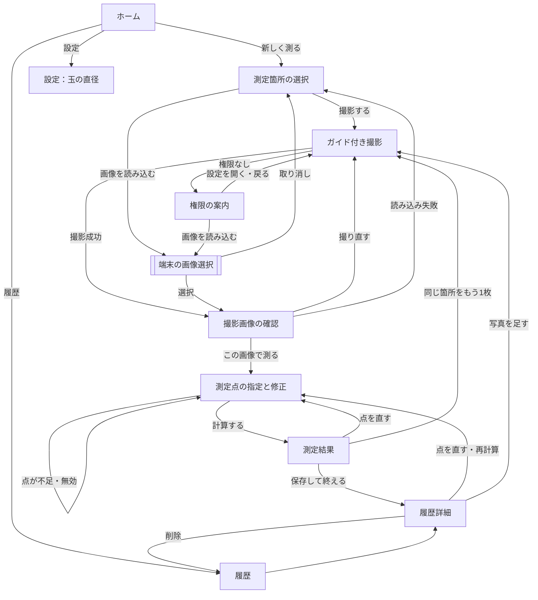

# 釘間隔の推定アプリ 設計書（nail_gauge）

作成：2026-10-31 Claude（設計のみ。アプリ本体は未実装）
関連：[measurement-validation.md](measurement-validation.md)（検証計画）、[implementation-plan.md](implementation-plan.md)（実装計画）

この文書の記号：

- **【確定】** 依頼で決まっていること。
- **【仮定】** 一般的な実装の選択で、合理的に決めて進めるもの。実装中に変えてよい。
- **【要検証】** 計測が成り立つかに関わり、実測するまで事実として扱わないもの。数値例は説明のための仮の値で、性能の約束ではない。

---

## 0. 置き場所と既存リポジトリとの関係

- 【仮定】このリポジトリ（`database`）の中に、新しいFlutterアプリ `nail_gauge/` として作る。既存の `database_android/` とは別のアプリにする（パッケージ名・アプリIDを分け、データも共有しない）。
  - 理由：カメラで寸法を測る機能は、既存アプリのどの画面とも対応せず、既存の取得・採点の仕組みに足す部分が無い。AGENTS.md の「関連アプリは既存databaseをベースに」は、見た目・作法の継承として守る：配色と部品の作り（`database_android/lib/theme.dart`）、`flutter_lints`、`sqflite` と `path_provider` による端末内保存、日本語の画面文言、試験の置き方。
  - 将来、回転率（既存の `PACHINKO.md` の4円パチンコの取り込み）と結びつけるときに、機種名・台番号の書き方を既存DBに合わせられるよう、測定記録に `machine_name`・`rack_no`・`store` を持たせる（§E）。今回は結びつけない。
- 【要決定・実装前】`.github/workflows/regression.yml` は `.md` 以外が変わると全試験（1回約23分）を流す。`nail_gauge/` のコードをpushするたびに、関係のない既存の試験で無料枠を使う。実装を始める前に、(a) `paths-ignore` に `nail_gauge/**` を足す、(b) 別リポジトリに分ける、のどちらかを利用者に確かめる（[implementation-plan.md](implementation-plan.md) のT0）。

---

## A. 製品仕様

### A-1. 目的

Androidスマートフォンのカメラでパチンコの盤面を撮り、ヘソ・ワープ周辺の釘の間隔を「約○mm（画像からの推定）」として示し、記録する。写っているパチンコ玉を寸法の基準にする。

最終的な体験：**ガイドに合わせてかざす → 自動で撮影・解析 → 間隔を表示**。ただし、そこへ行く前に、手動指定で「玉を基準にした推定がどこまで当たるか」を実測で確かめる（段階1・2）。

### A-2. 対象ユーザーと利用シーン

- 対象：パチンコの釘を自分で見比べたい個人（最初は利用者本人）。Flutterで開発する本人が、作りながら精度を確かめる。
- シーン：
  1. 遊技中または台の前で、ヘソ周辺を正面から撮る。その場で概算を見る。
  2. 家で、撮った写真や保存画像を読み込み、拡大して丁寧に指定し直す。
  3. 同じ台・同じ箇所を日を変えて記録し、変化を見比べる（相対比較）。
- 前提の注意：**店舗によって撮影が禁止・制限されている。** アプリは撮影の可否を判断しない。ホーム画面と初回起動時に「撮影は店舗のルールに従ってください」と出す。

### A-3. 段階ごとの機能

| 段階 | 目的 | 機能 |
|---|---|---|
| 1 手動指定で原理を確かめる | 式と座標の扱いが正しく、手動でどの程度の誤差か知る | ガイド付きの静止画撮影／保存画像の読み込み、拡大・移動、ルーペでの点の微調整、玉の指定（両端2点、または円周の3点以上）、対象の2点指定、推定値の計算、測定点付き画像・条件・結果の保存、履歴・再計算・削除 |
| 2 複数画像で測る | 写真ごとのばらつきを知り、不良な写真を除く | 同じ測定箇所の写真を束ねる（グループ）、連写（短い動画は要調査）、写真ごとの品質の印（ぼけ・反射・玉の隠れ）、各写真の値と中央値・範囲・ばらつき、除外とその理由、定義が違う測定を混ぜない仕組み |
| 3 自動検出と撮影支援 | 手動の手間を減らし、条件をそろえる | 玉・釘頭の検出、測定箇所の追跡、撮影品質の判定と自動撮影、検出結果を手で直す導線、機種別の目印・寸法データ（任意） |

手動指定は最終製品ではない。一方、自動化を先に作って計測誤差の検証を飛ばさない。段階3へ進む条件は [implementation-plan.md](implementation-plan.md) の「自動化へ進む判断条件」に書く。

### A-4. 初期版（段階1）の完成条件

1. 端末のカメラで撮るか、保存画像を読み込み、画像を拡大・移動できる。
2. 玉を「両端2点」または「円周3点以上」で指定でき、対象を2点で指定できる。ルーペで1画素未満まで位置を動かせる。
3. 推定値が式どおりに出る（合成画像の試験で、既知の答えと一致する。[measurement-validation.md](measurement-validation.md) V0）。
4. EXIFの向き8種類すべてで、保存した点が同じ画素に戻る（試験で確かめる）。
5. 無効な測定（点の不足・ゼロ距離・画像外・玉が小さすぎる等）で値を出さず、理由を出す。
6. 測定点付き画像・条件・結果が端末内に保存され、履歴から再表示・再計算・削除できる。
7. 結果の表示が「画像からの推定・未検証」であることが分かる。精度・信頼度の数値を出さない。
8. 既知寸法の模型（[measurement-validation.md](measurement-validation.md) V1）で、少なくとも1回の検証を流して結果を記録している。合否ではなく、現状の誤差を知ることが目的。

### A-5. 今回の対象外

- 回転率との関係の分析、既存DB（`database_android`）とのデータ連携。
- サーバー、ログイン、課金、クラウド同期、共有。
- 位置情報の取得。
- iPhone・PC版（Flutterなので後で足せるが、今回はAndroidだけ確かめる）。
- 「玉が実際に通れる最小の隙間」の算出（§C-2 の指標G。正面の画像1枚からは決まらない）。
- 釘の曲がり・傾きの角度の推定。
- 段階3の自動検出の実装（データ形式と境界だけ決めておく）。

### A-6. 未検証の仮説と確認方法

| 番号 | 仮説 | なぜ要検証か | 確認方法 |
|---|---|---|---|
| H1 | 盤面上の玉を、測る釘の近くで、輪郭がはっきり写る状態で撮れる | 遊技していなければ盤面に玉は無く、遊技中の玉は動いていてぶれる | 実機または模型で、連写・動画から「ぶれの少ない玉が測定箇所の近くにある写真」が何枚に1枚取れるかを数える（V6） |
| H2 | 玉の中心と釘頭の奥行きの差による倍率の誤差が、許せる範囲に収まる | 盤面から釘頭までの高さが分からない。奥行きの差の割合がそのまま誤差になる（§C-3） | 模型で釘頭の高さを変えて誤差を測る（V4）。実機の釘の突き出し量を、可能なら実測する |
| H3 | 釘頭の画像上の間隔と、玉が通る軸の間隔の関係が、測る位置の定義で一定に保てる | 頭は軸より太く、釘は傾いている。正面からは頭で軸が隠れる | 模型で頭の間隔・軸の間隔を別々に実測し、画像の値と比べる（V1・V4） |
| H4 | 正面からのずれ（傾き）が数度なら、誤差が小さい | ガイドだけでは正面を保証できない（§C-3-5） | 模型で角度を0・5・10・15度と変えて撮る（V4） |
| H5 | ガラス越しの屈折・反射は、玉と釘の比をあまり変えない | 玉も釘もガラスの奥なので理屈では影響が小さいが、斜めからや反射の写り込みは別 | 模型にガラス板を付けた／外したで比べる（V4） |
| H6 | 手動で点を置くばらつきは、推定値で約0.1mmより小さい | 1画素が何mmかは撮影距離による。0.1mmが何画素かを先に計算して比べる | 同じ画像を10回指定し直す（V2） |
| H7 | 端末の主カメラの歪みは、画像の中央付近なら無視できる | 端末の補正処理は機種ごとに違い、近距離で別のレンズに切り替わる機種がある | 方眼を撮って中央と端で比べる（V0b）。機種・レンズを記録する |
| H8 | 玉の実寸は公称11.0mmに近い | 摩耗・製造のばらつき。基準の誤差は全結果に同じ割合で乗る | 手元の玉をノギス等で測り、設定の「実測直径」と根拠に入れる |

---

## B. 画面設計

### B-0. 画面遷移図



画面の戻る操作（端末の戻る）は、表に書いた「失敗時の戻り先」と同じ先へ戻す。指定途中の点は、戻る前に「指定中の点を破棄しますか」と確かめる（未保存の作業を黙って捨てない）。

### B-1. ホーム

- 表示：「新しく測る」「履歴」「設定」。直近の測定3件（機種名・箇所・推定値・日付）。現在の玉の基準直径（例「玉の直径：11.0mm（公称値）」）。
- 説明：「画像から間隔を推定するアプリです。値は検証が済むまで目安です。」「撮影は店舗のルールに従ってください。」
- 操作：各ボタン。直近の測定を押すと履歴詳細。
- 失敗時：DBが開けない → エラーと「再試行」。画像ファイルが欠けた記録は履歴に「画像なし」と出す（記録は消さない）。

### B-2. 測定箇所の選択

- 表示と入力：
  - 箇所の種類：**ヘソ**／**ワープ入口**／**その他**。
  - 測る位置の定義（§C-2-2）：ヘソは「釘頭の内側の縁の間」（初期値）／「釘頭の中心の間」。ワープ・その他は「任意の2点」。
  - 既存のグループに足すか、新しく始めるか（同じ台・同じ箇所・同じ定義のグループだけ候補に出す）。
  - 任意：機種名、台番号、店、メモ。
- 説明：選んだ定義の図（ヘソの2本の釘頭と、測る線）。「定義が違う測定は、あとでまとめて集計しません。」
- 操作：「撮影する」「画像を読み込む」。
- 失敗時：画像選択を取り消したらこの画面に戻る（入力は保持）。

### B-3. ガイド付き撮影

- 表示：カメラのプレビュー。中央に測定箇所を入れる枠（ヘソ用は横長の枠と、2本の釘頭の目安の円）。枠の中に玉を入れる目安の円。端末の傾き（重力に対する角度）の目盛り（`sensors_plus` 等。下の注意）。
- 説明（画面上部に1行）：「測る釘と玉を枠の中央に。画面を盤面と平行に。玉がぶれていない写真を選びます。」
- 注意（説明の「？」から開く）：「傾きの目盛りは端末の向きだけを示します。盤面と平行かどうかは保証しません（台は傾いている場合があります）。」
- 操作：シャッター、（段階2）連写、ピントを合わせたい所をタップ、ライトの切り替え（反射が増えるので初期値は消灯）、画像を読み込む。
- 失敗時：
  - 権限が無い → 権限の案内（§D-6）。そこから「画像を読み込む」も選べる。
  - カメラの初期化に失敗・他のアプリが使用中 → 「カメラを開けませんでした」「再試行」「戻る（測定箇所の選択）」。
  - 撮影に失敗 → その場で再試行できる。プレビューは止めない。
- 記録すること：撮影時のプレビューの大きさ、ガイド枠の位置（プレビュー上の割合）、端末の傾き、ズーム倍率、ライトの有無、ピントの指定位置。ガイド枠と撮った画像の対応は推定でしかない（§C-6-4）。

### B-4. 撮影画像の確認

- 表示：撮った画像（向きを直したもの）。撮った条件（解像度、ズーム、傾き）。（段階2）ぼけの目安の印。
- 説明：「玉と測る釘がはっきり写っているか確かめてください。ぶれた玉、反射で輪郭が欠けた玉は基準に向きません。」
- 操作：「この画像で測る」「撮り直す」。連写のときは画像を横に送って選ぶ（複数選べる）。
- 失敗時：画像の読み込み・向きの処理に失敗 → 理由を出して測定箇所の選択へ戻る。撮った元ファイルは消さず、一時フォルダに残す（次回起動時に片付け）。

### B-5. 測定点の指定と修正

測定の中心の画面。誤操作しにくさを優先する。

- 表示：
  - 画像（拡大・移動。2本指で拡大、1本指でドラッグ移動）。
  - 置いた点と線：玉の点（青）、玉の円・直径線、対象の点（橙）と線。点ごとに名前（「玉・左端」「対象・左」）。
  - ルーペ：点をドラッグしている間、指で隠れない位置に、指の下の元画素を数倍に拡大して出す。十字線と、元画像の画素の格子。
  - 手順の表示（上部）：「1/2 玉の両端を置く」→「2/2 測る2点を置く」。今どれを置くかが分かる。
  - 画面下：今の値（玉の直径〇〇画素、対象〇〇画素、推定 約〇.〇mm）と、無効・注意の理由。
- 操作：
  - 点を置く：画像をタップ（その時点の手順の点を置く）。
  - 点を動かす：点を長押ししてドラッグ。ルーペで細かく動かす。微調整ボタン（上下左右、元画像の0.25画素ずつ）。
  - 玉の指定方法の切り替え：「両端2点」／「円周に点を置く（3点以上）」。円周の方法は、玉の一部が隠れていても見えている弧に置ける。
  - 玉の確認の印：「この玉は盤面上にある（上皿などではない）」「玉が一部隠れている」「ぶれている」。
  - 取り消し・やり直し、すべての点の消去。
- 説明：手順ごとに1行。例「玉の輪郭の外側の縁に、両端の点を置きます。直径は、測る線とおおむね同じ向きで取ってください」。ヘソで「頭の内側の縁の間」を選んでいるときは「釘の頭の内側の縁に置きます（軸ではありません）」。
- 失敗時：点が不足・画像外・ゼロ距離などのときは「計算する」を押せない（理由を出す）。その場で直す。
- 自動検出（段階3）の結果もこの画面で直す。自動で置いた点は形を変えて示し、動かしたら「手で修正」になる（§C-7）。

### B-6. 測定結果

- 表示：
  - 大きく「**約 9.4 mm**」、その下に「画像からの推定（未検証）」。小数第1位は表示の桁であって、0.1mmの精度ではない。初回表示時に、この意味を説明する1行を出す。
  - 玉に対する比「玉の直径の 0.85 倍」。基準直径を変えても変わらない値として並べる。
  - 使った基準：「玉の直径 11.0mm（公称値）」または「11.02mm（ノギスで実測、2026-11-02）」。
  - 定義：「ヘソ・釘頭の内側の縁の間（画像上の2点間）」。
  - 注意の一覧（§C-4 の注意）。例「玉が測る位置から離れています」。
  - 測定点付き画像のサムネイル。
  - （段階2）同じグループの各写真の値・中央値・範囲・枚数。
- 表示しないもの：「信頼度◯％」「誤差±◯mm」。検証が済んだ条件だけ、後で「検証済みの条件での誤差の目安」を、検証日と条件付きで出せるようにする（[measurement-validation.md](measurement-validation.md) §7）。画像品質の印は、寸法が正しい確率としては出さない。
- 操作：「点を直す」「同じ箇所をもう1枚」「保存して終える」。
- 失敗時：保存に失敗 → 「保存できませんでした」「再試行」。指定した点は画面に残す。

### B-7. 履歴

- 表示：グループの一覧（機種名・台番号・箇所・定義・写真の枚数・中央値・最終日）。並べ替え（新しい順／機種名）、箇所で絞り込み。
- 操作：開く、長押しで削除（確認つき）。
- 失敗時：画像が欠けたものは「画像なし」と出す。

### B-8. 履歴詳細

- 表示：グループの情報、各写真の行（サムネイル、推定値、玉の画素数、注意、除外の有無と理由、手動／自動、計算方式の版）、集計（§C-5）。
- 操作：写真を開いて点を直す、再計算（基準直径・計算方式の版を今のものにする）、除外／除外解除（理由を入力）、写真を足す、写真の削除、グループの削除、機種名・メモの編集。
- 再計算したら、前の結果も残し（§E）、「再計算しました（11.0mm → 11.02mm）」と出す。

### B-9. 設定

- 玉の基準直径：公称値（初期11.0mm）と、実測値（任意）を別に持つ。実測値を使うときは測り方・道具・日付を入れる。どちらを計算に使うかを選ぶ。
- 測定の初期値（箇所・定義・玉の指定方法）。
- 画像の保存（容量の表示、画像を残さず結果だけ残す選択は付けない：再計算・検証ができなくなるため）。

---

## C. 計測処理の設計

### C-1. 処理の入力と出力

入力：

- 画像1枚（正規化した座標系 §C-6 の画素の幅・高さ）。
- 玉の指定：両端2点、または円周の点3つ以上（すべて正規化座標）。
- 対象の指定：2点。
- 基準直径（mm）と、その根拠（公称／実測）。
- 測定位置の定義（§C-2-2）。
- 補助情報：玉の確認の印（盤面上・隠れ・ぶれ）。

出力（`MeasurementResult`）：

- `ball_diameter_px`、`target_distance_px`、`ratio = target_distance_px / ball_diameter_px`
- `estimate_mm = ratio × reference_diameter_mm`
- `status`：`valid`／`invalid`
- `errors`：無効の理由（値を出さない）
- `warnings`：注意（値は出すが注意を添える）
- `calc_version`：計算方式の版（§C-8）
- 補助の値：玉の中心、玉と対象の中点の距離（玉の直径の何倍か）、円の当てはめの残差、玉の向き別の直径の差。

### C-2. 計算式と、混同しない指標

#### C-2-1. 基本式

```
推定間隔mm = 対象の画素距離 / 玉の直径の画素数 × 基準直径mm
```

- 対象の画素距離：対象の2点のユークリッド距離（正規化座標、実数）。
- 玉の直径の画素数：両端2点ならその距離。円周の点なら、最小二乗で当てはめた円の直径（§C-2-3）。
- 内部は倍精度のまま持ち、丸めるのは表示のときだけ（表示は小数第1位、mmの四捨五入）。

#### C-2-2. 測る位置の定義

ヘソは釘のどの部分を測るかを決めないと、同じ台でも値が揃わない。正面の写真では、釘の軸は頭に隠れて見えない。

| 定義ID | 名前 | 何を測るか | 備考 |
|---|---|---|---|
| `heso_head_inner` | 釘頭の内側の縁の間 | 左右の釘頭の輪郭のうち、互いに最も近い縁どうし | ヘソの初期値。画像で直接見える縁を使う |
| `heso_head_center` | 釘頭の中心の間 | 左右の釘頭の中心どうし | 頭の大きさの影響を受けにくい。頭の円に点を置いて中心を求める（段階1では中心を目で置く） |
| `free_two_point` | 任意の2点 | 利用者が選んだ2点 | ワープ・その他。点の意味をメモに残すよう促す |

- いずれも「画像上で指定した2点間の推定距離」であり、玉が通れる隙間ではない。
- 「釘頭の内側の縁の間」と「玉が通る軸の間」は、頭と軸の太さの差と、釘の傾きによって違う。この差は正面の写真1枚からは決まらない【要検証 H3】。

#### C-2-3. 玉の直径の取り方

- **両端2点**（依頼どおりの基本）：玉の輪郭の外側の縁に、直径の両端を置く。直径の向きは、測る線とおおむね同じ向きにする（§C-3-3）。
- **円周の点（3点以上）**：見えている輪郭に点を置き、円を当てはめる（代数的な最小二乗法、Kåsa法で始め、必要なら幾何的な当てはめに替える）。
  - 3点ちょうどなら外接円。点がほぼ一直線（3点の面積が小さい）なら無効。
  - 点が覆う弧の角度が狭い（例：90度未満【仮の閾値】）と直径が不安定になるので注意を出す。
  - 残差（点から円までの距離の二乗平均）が大きいときは注意を出す。
- 玉が隠れているときは、両端2点を使わせない（見えない端を推測で置くことになる）。円周の点を使う。

#### C-2-4. 混同しない4つの指標

| 記号 | 指標 | このアプリでの扱い |
|---|---|---|
| P | 画像上で指定した2点間の推定距離（mm） | 段階1から表示する値。「推定」と明記 |
| G | 玉が実際に通過する最小の隙間 | 算出しない（§A-5）。Pとは別物と画面・文書で明記 |
| S | 写真間の測定値のばらつき（範囲・標準偏差） | 段階2で表示。Sが小さくても、真の値に近いとは言えない |
| E | 真の寸法に対する測定誤差 | 真値が分かる検証（模型など）でだけ求める。アプリの通常の画面には出さない |

### C-3. 式を近似として使える条件と限界

前提とするモデル：歪みのないピンホールカメラ。焦点距離（画素） f、カメラから奥行き Z にある、カメラに平行な平面上の長さ L は、画像上で `f·L/Z` 画素になる。

基本式が正しいのは、**玉の直径と対象の2点が、同じ奥行きの、カメラに平行な平面上にある**ときだけ。以下はそこからのずれ。

#### C-3-1. 玉と釘の奥行きの違い

対象が奥行き Z_t、玉の中心が Z_b にあるとき：

```
推定値 = 真の値 × (Z_b / Z_t)
相対誤差 ≈ (Z_b − Z_t) / Z_t
```

- 玉は盤面とガラスの間を転がるので、玉の中心は盤面から約5.5mm（玉が盤面に接しているとき）。釘頭は盤面から釘が突き出した先にある。釘頭のほうがカメラに近いと、推定値は大きめに出る。
- 数値例【仮の値】：カメラから釘頭まで150mm、奥行きの差5mm → 約3.3%。10mmの間隔なら約0.33mm。**この誤差は複数枚の平均では減らない**（撮り方が同じなら毎回同じ向きにずれる）。
- 奥行きの差が分かれば補正できる（`Z_t = Z_b − Δ` として比を直す）が、Z_b（撮影距離）も Δ も写真1枚からは分からない【要検証 H2】。段階1では補正せず、検証の結果を見て判断する。

#### C-3-2. 斜め撮影による見え方の変化

- 盤面がカメラに対して角度 α だけ傾いていると、画像の場所によって倍率が変わる。玉と対象が画像上で距離 s 離れていれば、奥行きの差はおおよそ `s·tan α` 分生じ、§C-3-1 と同じ形の誤差になる。**玉を対象の近くで使う**ほど小さくなる。
- 傾いた平面上の線分は、向きによって縮み方が違う（傾きの軸に直交する向きの線は `cos α` 倍に縮む）。玉（球）は縮まないので、比が向きによって変わる。数値例【仮】：α=10度で最大約1.5%。
- 平面の画像補正（射影変換）は、一つの平面上の点にしか正しく効かない。玉の中心と釘頭は奥行きが違うので、盤面の平面で補正しても両方を同時には直せない（§C-3-8）。

#### C-3-3. 玉が球であること

- 球は、画像の中心から離れた場所では、中心から外へ向かう方向（放射方向）に伸びた楕円に写る。ピンホールモデルでは、球の中心が光軸から角度 θ の所にあるとき：
  - 放射方向に直交する向きの直径 ≈ `2fR/Z`（同じ奥行きの平面上の長さと同じ倍率）
  - 放射方向の直径 ≈ `2fR/(Z·cos θ)`（`1/cos θ` 倍に伸びる）
  - 数値例【仮】：θ=10度で約1.5%、θ=20度で約6.4%。スマートフォンの主カメラの画面の端は θ が30度を超えることがある。
- 対策：玉と対象を**画像の中央付近**に置く。玉の直径は放射方向に直交する向きで取ると、理屈では伸びの影響を受けない（段階1では「測る線とおおむね同じ向きで、画像の中央近く」と案内し、向きと位置を記録する）。円周の点で指定したときは、楕円の当てはめで短径を使う案も検証する【要検証】。
- 球の輪郭（縁）は、平面上の円の縁と違って、照明によって明るさがなだらかに落ちる。どこを縁とみなすかで直径が数画素変わりうる【要検証 H6】。
- 球が近いときの見かけの大きさの増加 `1/√(1−(R/d)²)` は、撮影距離150mmで約0.07%【仮】で、ほかの要因より小さい。

#### C-3-4. レンズの歪み、ガラスの屈折・反射

- 歪み：端末の主カメラは処理で補正されていることが多いが、残りは機種ごとに違う。画像の端ほど大きい。玉と対象を中央付近・近くに置けば影響は小さい【要検証 H7】。近距離で別のレンズに切り替わる端末があるので、使ったレンズ・ズームを記録する。超広角レンズは使わない。
- ガラス：平らなガラス板の奥の物は、正面から見ると、厚み t・屈折率 n で `t(1−1/n)` だけ手前に見える。玉も釘もガラスの奥にあるので、比への影響は小さいはず。斜めから撮ると像のずれ方が場所で変わる【要検証 H5】。
- 反射：照明やライトの反射で、玉・釘頭の縁が欠けたり太って見えたりする。点を置く人が気づけるように、確認の画面と注意で促す。端末のライトは初期値で消灯。

#### C-3-5. ガイドで保証できないこと

ガイドの枠と傾きの目盛りは、**撮り方を毎回そろえるための補助**で、次のことは保証しない。

- 盤面に対して正面であること（目盛りは重力に対する端末の傾き。台の盤面が鉛直とは限らない）。
- 撮影距離（倍率）。玉を基準にするので距離自体は要らないが、奥行きの差の誤差（§C-3-1）は距離で変わる。
- 絶対寸法の正しさ。

#### C-3-6. 動く玉のぶれ、輪郭の欠け

- ぶれの長さ = 玉の速さ × 露光時間。数値例【仮】：毎秒500mm・1/60秒なら約8mmで、玉の直径に近い。動いている玉は原則として基準に向かない。
- ぶれは動く向きに玉を伸ばす。動く向きに直交する直径は伸びないが、縁がにじむ。これを使えるかは【要検証 H1】。
- Flutterの `camera` パッケージで露光時間を直接指定できるかは、版と端末によるため未確認【要調査】。できない場合、明るさの補正と連写で「たまたまぶれの少ない写真」を選ぶ方式になる。
- 玉が釘・役物・反射で一部隠れているときは、両端2点ではなく円周の点で指定する（§C-2-3）。

#### C-3-7. 釘の頭と軸の見分け

- 正面からは、釘頭が軸を隠す。画像で見えるのは主に頭の輪郭。
- 頭の縁を軸の縁と取り違えると、頭と軸の太さの差だけ値がずれる。定義（§C-2-2）を頭で決めたのはこのため。
- 斜めから撮れば軸が見えるが、§C-3-2 の誤差が増える。軸を測る方式は段階1では作らない。

#### C-3-8. 画像に写る間隔と、玉が通る隙間の違い

- 玉は盤面から玉の半径ほどの高さで釘の軸の間を通る。釘は傾けられていることがあり、軸の、玉の中心の高さでの間隔は、頭の間隔とも頭の中心の間隔とも違う。
- 指標Pと指標Gは別物。アプリは指標Gを出さない。将来扱うなら、機種ごとの釘の形の情報や、別の角度の写真が必要になる。

### C-4. 無効な測定と注意

無効（値を出さない）：

| コード | 条件 |
|---|---|
| `ball_points_missing` | 玉の点が足りない（両端2点の方式で2点未満、円周の方式で3点未満） |
| `target_points_missing` | 対象の点が2点未満 |
| `point_outside_image` | 点のどれかが画像の外（`0 ≤ x ≤ 幅`、`0 ≤ y ≤ 高さ` の外） |
| `ball_zero` | 玉の直径が最小値未満（ゼロ距離・同じ所に2点を含む）。最小値は【仮】1画素 |
| `target_zero` | 対象の距離が最小値未満（【仮】0.5画素） |
| `ball_too_small` | 玉の直径が小さすぎる（【仮】40画素未満。1画素の置き違いで2.5%以上変わる大きさ）。検証で見直す |
| `circle_degenerate` | 円周の点がほぼ一直線で円が決まらない |
| `ball_occluded_two_point` | 「玉が一部隠れている」の印があるのに両端2点で指定した |
| `ball_not_on_board` | 「盤面上の玉」の確認が外されている（上皿の玉などはガラスの手前で奥行きが大きく違う） |
| `reference_unset` | 基準直径が無い・0以下 |

注意（値を出し、理由を添える）：

| コード | 条件（閾値は【仮】、検証で見直す） |
|---|---|
| `ball_far_from_target` | 玉の中心と対象の中点が、玉の直径の3倍より離れている |
| `off_center` | 玉か対象が、画像の中心から画像の対角線の4分の1より外にある |
| `narrow_arc` | 円周の点が覆う弧が90度未満 |
| `fit_residual_high` | 円の当てはめの残差が0.5画素を超える |
| `ball_blurred` | 「ぶれている」の印がある |
| `target_longer_than_view` | 対象の距離が玉の直径の5倍を超える（玉から遠い所まで同じ倍率とみなしている） |
| `reference_nominal` | 基準直径が公称値のまま（実測していない） |

### C-5. 複数画像の対応付けと集計

- **グループ**＝同じ台・同じ箇所・同じ定義の測定の束。グループの鍵は `(店, 台番号, 機種名, 箇所の種類, 箇所の名前, 定義ID)`。写真を足すときは、この鍵が同じグループにだけ足せる。違う位置・高さ・定義の値を同じ集計に入れない。
- ワープなど `free_two_point` のときは、最初の写真の測定点の付近の画像（サムネイル）を出し、「同じ2点を測っていますか」を利用者が確かめる。自動で同じ点だと決めない（段階3で、追跡の結果を候補として出す）。
- 撮影日が違う写真は、釘が調整されている可能性があるので、グループの中で日ごとに分けて集計する（初期値）。日をまたいだ比較は並べて見せるだけにする。
- 集計の値（有効で、除外していない測定だけ）：
  - 枚数 n、**中央値**（主に見せる値）、最小・最大（範囲）、n≥3のときの標準偏差、中央値からの絶対偏差の中央値（MAD）。
  - 平均は出してよいが、主の値は中央値（点の置き間違いに強いため）。
- 外れ値：中央値からMADの3倍より離れた値に印を付ける。**自動では除外しない。** 除外は利用者が理由を付けて行い、記録に残す。
- 平均で減るもの・減らないもの：
  - 減らせる（写真ごとに向きがばらばらなもの）：点の置き方の揺れ、画像のノイズ、玉の縁の見え方の揺れ、手ぶれの小さな違い。おおよそ枚数の平方根に反比例して小さくなる（揺れが互いに独立なら）。
  - 減らせない（毎回同じ向きにずれるもの）：玉と釘の奥行きの差、基準直径の誤り、定義と玉が通る隙間の違い、毎回同じ構えでの傾き、レンズの歪みの残り、点を置く人の癖（縁を毎回少し外に置く等）。
  - 画面では「写真間のばらつき（S）」と表示し、「誤差」とは書かない。

### C-6. 座標の扱い

#### C-6-1. 座標系の定義

| 名前 | 内容 |
|---|---|
| 元ファイル座標 R | JPEGに記録されたままの画素の並び（EXIFの向きを当てる前）。幅 W_r・高さ H_r |
| **正規化座標 C（保存の基準）** | Rに、EXIFの向き（Orientation 1〜8）を当てたあとの画像の座標。拡大・縮小・切り抜きはしない。幅 W・高さ H |
| 表示用画像座標 D | Cを、表示のために縮小した画像の座標。`D = s·C`（s ≤ 1、縦横同じ倍率） |
| 画面上の座標 V | 拡大・移動の変換 M（`InteractiveViewer` の `TransformationController` の行列）を当てたあとの、画像を表示する部品の中の座標 |

- 画素の座標は連続値で扱い、画素 (i, j) は `[i, i+1) × [j, j+1)` を占め、中心は `(i+0.5, j+0.5)`。画像の範囲は `0 ≤ x ≤ W`、`0 ≤ y ≤ H`。
- **保存する点はすべて正規化座標 C の実数**。画面の座標・表示用画像の座標は保存しない（画面の大きさ・縮小率が変わっても点がずれないように）。

#### C-6-2. EXIFの向き（R → C）

| Orientation | 意味 | 正規化座標の幅×高さ | R(x, y) → C |
|---|---|---|---|
| 1 | そのまま | W_r × H_r | (x, y) |
| 2 | 左右反転 | W_r × H_r | (W_r − x, y) |
| 3 | 180度回転 | W_r × H_r | (W_r − x, H_r − y) |
| 4 | 上下反転 | W_r × H_r | (x, H_r − y) |
| 5 | 転置 | H_r × W_r | (y, x) |
| 6 | 時計回りに90度 | H_r × W_r | (H_r − y, x) |
| 7 | 反転して転置 | H_r × W_r | (H_r − y, W_r − x) |
| 8 | 反時計回りに90度 | H_r × W_r | (y, W_r − x) |

- 段階1では、読み込み時に画像を復号してEXIFの向きを画素に焼き込み（`image` パッケージの `bakeOrientation` 等【APIは実装時に確認】）、以後は C だけを扱う。R→C の表は、焼き込みが正しいかの試験と、元ファイルに戻って検証するときに使う。
- Flutterの `Image` 部品がEXIFの向きを当てて表示するかは、端末・版に任せず、**焼き込んだ画素から作った画像を表示する**ことで依存しないようにする【仮定】。

#### C-6-3. 拡大・移動・切り抜き（V ↔ C）

- 画面の点 V から保存の点 C へ：`D = M⁻¹·V`、`C = D / s`。逆は `V = M·(s·C)`。
- 表示用画像は長い辺を【仮】4096画素以下に縮小する（端末のテクスチャの上限を超えないため。上限は端末で違う【要確認】）。ルーペは C の元の解像度の画像から切り出して描く。
- 切り抜き（クロップ）は保存画像を切らない。表示の範囲や、自動検出の対象範囲は、C の矩形 `{x, y, w, h}` として持つ。元の画像を切り抜いて保存すると、後から座標の基準が変わるため。
- 点のドラッグは、画面での指の移動量 ΔV を `ΔC = ΔV / (s × 拡大率)` で C に直して足す。微調整ボタンは C で0.25画素ずつ動かす。

#### C-6-4. プレビューの座標と保存画像の座標の違い

- カメラのプレビューは、保存画像より解像度が低く、縦横比が違うことがある。画面いっぱいに見せるために端を切って（cover）表示すると、プレビューに見えている範囲と保存画像の範囲が一致しない。
- ガイド枠はプレビュー上に描くので、保存画像の中での位置は推定でしかない。保存するのは「プレビュー上の枠の位置（割合）」「プレビューの縦横比」「表示の切り方」で、保存画像の座標は計算した推定値として別に持つ。
- 測定点は、必ず保存画像（C）の上で置く。プレビューの上では置かない。
- 対応のずれは、方眼を撮って確かめる【要検証、実装計画T4】。

#### C-6-5. 元画像の保存

- カメラで撮ったJPEGは、そのままアプリの保存フォルダへ移す（再圧縮しない）。SHA-256を記録して、後で同じ画像か確かめられるようにする。
- 端末の画像を読み込んだときは、位置情報（EXIFのGPS）があるかを確かめる。ある場合は、向きを焼き込んで位置情報を含まない形で保存し直し（JPEGの品質は【仮】95、または可逆のPNG）、`reencoded: true` と元のSHA-256を記録する。カメラで撮った画像に位置情報が入らないことも試験で確かめる【要確認】。
- 履歴用に、長い辺が【仮】1024画素の縮小画像を別に作る。

### C-7. 自動検出と手動指定で共通のデータ形式

点は、誰が置いたかに関係なく同じ形で持つ。

```json
{
  "frame": "canonical_v1",
  "ball": {
    "method": "two_point",
    "points": [
      {"role": "ball_edge", "x": 1834.25, "y": 1502.75, "source": "manual"},
      {"role": "ball_edge", "x": 2046.50, "y": 1499.00, "source": "manual"}
    ],
    "flags": {"on_board": true, "occluded": false, "blurred": false}
  },
  "target": {
    "definition": "heso_head_inner",
    "points": [
      {"role": "target_a", "x": 1720.00, "y": 1210.50, "source": "auto",
       "detector": {"name": "nail_head_v0", "version": "0.1.0"}, "score": 0.81},
      {"role": "target_b", "x": 1903.75, "y": 1212.25, "source": "manual_edited",
       "edited_from": {"x": 1899.0, "y": 1213.0, "source": "auto"}}
    ]
  }
}
```

- `source`：`manual`（手で置いた）／`auto`（自動で置いて手を付けていない）／`manual_edited`（自動で置いたあと手で動かした）。`manual_edited` は元の自動の位置を `edited_from` に残す（自動検出の性能を後で測るため）。
- `score` は検出器の内部の値で、寸法の正しさの確率ではない。画面に「信頼度」として出さない。
- `method`：`two_point`／`circle_points`／`circle`（自動検出が円を直接返す場合、`{"cx","cy","r"}` を持つ）。
- 段階3で検出器を足しても、この形の `source` と `detector` を埋めるだけで、計算・保存・画面は変えない。

### C-8. 計算方式の版

- `calc_version` は、結果を出した計算の版（例 `"1.0.0"`）。式・円の当てはめ・無効と注意の閾値を変えたら版を上げる。
- 結果には、使った版・基準直径・根拠を写して保存する。設定を後で変えても、過去の結果の意味が変わらない。
- 再計算は、点はそのままに、今の版と今の基準直径で結果を作り直し、前の結果も残す（§E）。

---

## D. Flutter構成

### D-1. ディレクトリ構成

```
nail_gauge/
  pubspec.yaml
  analysis_options.yaml        # database_android と同じく flutter_lints
  lib/
    main.dart                  # 起動、DB・設定の読み込み、MaterialApp
    theme.dart                 # database_android/lib/theme.dart の配色・部品を元にする
    measure/                   # 計測ロジック（Flutterに依存しない純Dart）
      geometry.dart            # 点・距離・円の当てはめ
      image_frame.dart         # EXIFの向き、座標系の変換
      calculator.dart          # 推定値、無効・注意の判定、calc_version
      aggregate.dart           # グループの集計
      models.dart              # 測定・点・結果のデータ型とJSON
    imaging/
      image_loader.dart        # 別Isolateで復号・向きの焼き込み・縮小・位置情報の確認
    camera/
      camera_session.dart      # CameraControllerの生成・解放・権限・ライフサイクル
    storage/
      database.dart            # sqfliteのテーブルと移行
      measurement_store.dart   # 測定・グループ・画像の保存、削除、再計算の保存
      image_files.dart         # 画像ファイルの移動・縮小画像・孤立ファイルの片付け
      settings_store.dart      # 基準直径などの設定
    pages/
      home_page.dart
      target_page.dart
      capture_page.dart
      review_page.dart
      marking_page.dart        # 測定点の指定（ルーペ・点の描画を含む）
      result_page.dart
      history_page.dart
      history_detail_page.dart
      settings_page.dart
    widgets/
      loupe.dart
      marker_painter.dart
  test/
    measure/                   # 計算・座標・集計の単体試験
    storage/                   # sqflite_common_ffi での保存・削除・再計算
    imaging/                   # EXIF 8種類の焼き込み
    pages/                     # 主要画面の部品試験
  tool/
    make_synthetic_images.dart # 検証用の合成画像（V0）
```

- `measure/` は `dart:ui` も Flutter も読み込まない。単体試験が速く、将来ほかの環境（PCでの検証スクリプト）からも使える。
- 抽象化は最小にする：保存は `MeasurementStore` 1つ（差し替え用のインターフェースは作らない。試験は `sqflite_common_ffi` で本物を使う。既存アプリと同じ）。検出器のインターフェースも段階3まで作らない（データ形式 §C-7 だけ決めておく）。

### D-2. 主要クラスと責務

| クラス | 場所 | 責務 |
|---|---|---|
| `Point2`、`Circle` | measure/geometry.dart | 実数の点、距離、円の当てはめ（Kåsa法）、弧の角度、残差 |
| `ImageFrame` | measure/image_frame.dart | 正規化座標の幅・高さ、EXIFの向き、R↔C、C↔D の変換 |
| `BallMark`、`TargetMark`、`MarkPoint` | measure/models.dart | §C-7 の点のデータとJSON |
| `MeasurementCalculator` | measure/calculator.dart | 入力から `MeasurementResult`（値・無効・注意・版）を作る。純関数 |
| `GroupSummary` | measure/aggregate.dart | 中央値・範囲・標準偏差・MAD・外れ値の印 |
| `LoadedImage`、`ImageLoader` | imaging/image_loader.dart | 別Isolateで、元ファイル→向きの焼き込み→表示用縮小・ルーペ用の元解像度→`ui.Image` |
| `CameraSession` | camera/camera_session.dart | 権限、初期化、撮影、ズーム・ピント、解放、アプリの一時停止・復帰 |
| `MeasurementStore` | storage/measurement_store.dart | グループ・測定・画像・結果の読み書き、削除、再計算の保存 |
| `MarkingController` | pages/marking_page.dart | 指定中の点・手順・取り消し履歴を持つ `ChangeNotifier`。保存はしない |

### D-3. 状態管理

**`ChangeNotifier`（＋`ListenableBuilder`／`ValueListenableBuilder`）を使う。** 追加のパッケージは入れない。

- 理由：既存の `database_android` が `ChangeNotifier`（`AppController`）で書かれていて、利用者が読み慣れている。画面の数が少なく、状態の多くは画面ごと（測定点の指定中の点など）で、アプリ全体で共有するのは設定と保存くらい。依存注入の仕組みは、`main.dart` で作ったものを画面の引数で渡せば足りる。
- 共有の状態：`AppState`（設定・保存の入口、`ChangeNotifier`）を `main.dart` で作って渡す。
- 画面ごとの状態：`MarkingController`、`CameraSession` は画面で作り、画面の `dispose` で捨てる。

### D-4. 利用パッケージの候補と役割

版やAPIは実装時に pub.dev と各パッケージの説明で確かめる。ここに書いた名前と役割は候補で、最新版の使い方を断定しない。

| パッケージ | 役割 | 段階 | 備考 |
|---|---|---|---|
| `camera` | プレビュー・撮影・ズーム・ピント・ライト | 1 | Flutter公式。露光時間の直接指定や、近距離でのレンズ切り替えの扱いは要確認 |
| `image` | 復号、EXIFの読み取りと向きの焼き込み、縮小、位置情報の確認と再保存 | 1 | 既存アプリでも使用中 |
| `sqflite` | 測定の保存 | 1 | 既存アプリと同じ |
| `path_provider`、`path` | アプリの保存フォルダ | 1 | 既存アプリと同じ |
| `image_picker` または `file_picker` | 端末の画像の読み込み | 1 | 既存アプリは `file_picker`。写真の選択画面がどちらで出るか確かめて選ぶ |
| `crypto` | SHA-256 | 1 | |
| `sensors_plus` | 端末の傾きの目盛り | 1 | 目安だけ |
| `permission_handler` または `app_settings` | 権限を「今後表示しない」で拒否されたときに設定画面を開く | 1 | `camera` の例外だけで足りるなら入れない |
| `sqflite_common_ffi` | PCでの保存の試験 | 1 | 既存アプリと同じ |
| 動画から画像を取り出すもの | 短い動画の利用 | 2 | 候補（`video_player` での取り出し、ネイティブの `MediaMetadataRetriever` 等）の現状を調査してから決める。まず連写で代える |
| `opencv` 系のFlutterパッケージ、またはネイティブ（Kotlin）のOpenCV | 自動検出 | 3 | 必要と分かってから（§D-9） |

### D-5. 画面・計測・カメラ・保存の分離

- 画面（`pages/`）は、`measure/` の純関数を呼んで結果を表示し、`storage/` で保存する。画面の中で計算式を書かない。
- `camera/` は撮った画像のファイルパスを返すだけ。測定のデータ型を知らない。
- `imaging/` はファイルパスから `LoadedImage`（`ImageFrame` と表示用・元解像度の画像）を返すだけ。
- `storage/` は `measure/models.dart` のデータ型を受け取り、JSONで保存する。計算はしない（再計算は画面から `MeasurementCalculator` を呼んで、結果を保存する）。

### D-6. カメラ権限

- 撮影画面を開いたときに `camera` の初期化で権限を求める（Androidの権限の画面が出る）。
- 拒否されたら、権限の案内の画面を出す：「カメラの使用が許可されていません。撮影には許可が必要です。保存済みの画像から測ることもできます。」ボタンは「もう一度許可を求める」「設定を開く」（今後表示しない、で拒否されたとき）「画像を読み込む」「戻る」。
- 例外の種類（拒否・今後表示しない・端末の制限）の名前は `camera` の版で違うことがあるため、実装時に確かめる。
- マイクの権限は求めない（`enableAudio: false`）。位置情報の権限は求めない。

### D-7. カメラの解放とライフサイクル

- `CameraSession` は撮影画面の `State` が持ち、`WidgetsBindingObserver` でアプリの状態を見る。
  - `inactive`／`paused`：コントローラを解放する（他のアプリがカメラを使えるように。Androidでは解放しないと復帰時に失敗することがある）。
  - `resumed`：撮影画面が表示中なら作り直す。権限が後から外された場合は案内へ。
- 撮影が終わって確認画面へ移るときは、プレビューを止めて解放してから重い画像の処理を始める（メモリを空けるため）。撮り直すときに作り直す。
- 二重の初期化・解放を避けるため、`CameraSession` は「初期化中」「使用可」「解放済み」を持ち、初期化中の呼び出しを待たせる。

### D-8. 画像処理でUIを止めない

- 復号・向きの焼き込み・縮小・位置情報の確認・SHA-256は `Isolate.run`（`compute`）で行う。12〜50メガ画素の画像の復号は数百ミリ秒〜数秒かかりうる【要測定】。
- Isolateの間で大きなバイト列を渡すときは `TransferableTypedData` を使い、複製を避ける。
- 処理中は進み具合（「画像を準備しています」）を出し、取り消せるようにする。
- 点のドラッグ中の再計算は軽い（数点の距離）ので、メインのIsolateで毎フレーム行ってよい。
- 円周の点の当てはめも、点が数十個なら軽い。段階3の検出はIsolate（またはネイティブのスレッド）で行う。

### D-9. 将来のネイティブ処理・OpenCVの境界

- 段階1・2では使わない。手動の指定と、純Dartの計算で足りる。
- 必要になるのは段階3で、次のどれかが要るとき：
  - 円の検出（ハフ変換）や輪郭の当てはめを、1秒に何回もの速さで行う（撮影支援・追跡）。
  - ぼけの度合い（ラプラシアンの分散など）を、プレビューの毎フレームで出す。
  - 方眼などを使ったレンズの歪みの補正。
- 境界：**入力は「正規化座標の画像（または切り出した領域）」、出力は §C-7 の点のデータ**。Dartの計算・保存・画面は、検出器が何で書かれていても変わらない。プレビューのフレーム（YUV）を使う場合は、フレームの座標から保存画像の座標への対応（§C-6-4）を、検出器の外で行う。
- 機械学習（玉・釘頭の検出の学習済みモデル）は、古典的な画像処理で検出が安定しないと分かってから検討する。学習用と検証用のデータを分ける（[measurement-validation.md](measurement-validation.md) §6）。

---

## E. 保存形式

### E-1. 保存場所

- 画像：`<アプリの保存フォルダ>/images/<image_id>.<拡張子>`、縮小画像：`<…>/thumbs/<image_id>.jpg`。
- DB：`<アプリの保存フォルダ>/nail_gauge.sqlite3`。
- アプリの保存フォルダは `path_provider` の `getApplicationDocumentsDirectory`（アプリ専用。端末のギャラリーには出さない）。
- 位置情報は取得しない・保存しない（§C-6-5）。

### E-2. テーブル

```sql
-- 基準直径（公称値と実測値を区別し、変更の履歴を残す）
CREATE TABLE ball_references (
  id TEXT PRIMARY KEY,              -- UUID
  diameter_mm REAL NOT NULL,        -- 11.0 など
  basis TEXT NOT NULL,              -- 'nominal' | 'measured'
  method TEXT,                      -- 'caliper' | 'micrometer' | 'other'（実測のとき）
  note TEXT,                        -- 「玉10個をノギスで測った平均」など
  measured_on TEXT,                 -- 実測した日（YYYY-MM-DD）
  created_at TEXT NOT NULL,
  active INTEGER NOT NULL DEFAULT 0 -- 今使っているものに1
);

-- 同じ測定箇所の束
CREATE TABLE measurement_groups (
  group_id TEXT PRIMARY KEY,
  target_kind TEXT NOT NULL,        -- 'heso' | 'warp' | 'other'
  target_label TEXT,                -- 「ヘソ」「ワープ入口（左）」など
  definition_id TEXT NOT NULL,      -- 'heso_head_inner' | 'heso_head_center' | 'free_two_point'
  store TEXT, machine_name TEXT, rack_no TEXT, memo TEXT,
  created_at TEXT NOT NULL, updated_at TEXT NOT NULL
);

-- 画像
CREATE TABLE images (
  image_id TEXT PRIMARY KEY,
  file_name TEXT NOT NULL,          -- images/ からの相対パス
  sha256 TEXT NOT NULL,
  source TEXT NOT NULL,             -- 'camera' | 'gallery' | 'burst' | 'video_frame'
  reencoded INTEGER NOT NULL DEFAULT 0,
  original_sha256 TEXT,             -- 再保存したときの元ファイル
  raw_width INTEGER NOT NULL, raw_height INTEGER NOT NULL,
  exif_orientation INTEGER NOT NULL,-- 1〜8（無ければ1）
  width INTEGER NOT NULL, height INTEGER NOT NULL, -- 正規化座標の幅・高さ
  captured_at TEXT,                 -- 撮影日時（端末の時刻、日本時間でISO 8601）
  capture_json TEXT                 -- 撮影条件（下の例）
);

-- 1枚の画像の上の1回の測定（点は自動・手動共通の形）
CREATE TABLE measurements (
  measurement_id TEXT PRIMARY KEY,
  group_id TEXT NOT NULL REFERENCES measurement_groups(group_id) ON DELETE CASCADE,
  image_id TEXT NOT NULL REFERENCES images(image_id),
  marks_json TEXT NOT NULL,         -- §C-7 の形
  origin TEXT NOT NULL,             -- 'manual' | 'auto' | 'auto_edited'（点の source から導く要約）
  excluded INTEGER NOT NULL DEFAULT 0,
  exclusion_reason TEXT,
  created_at TEXT NOT NULL, updated_at TEXT NOT NULL
);

-- 計算の結果（再計算のたびに1行足す。最新を表示）
CREATE TABLE measurement_results (
  result_id TEXT PRIMARY KEY,
  measurement_id TEXT NOT NULL REFERENCES measurements(measurement_id) ON DELETE CASCADE,
  calc_version TEXT NOT NULL,
  reference_diameter_mm REAL NOT NULL,
  reference_basis TEXT NOT NULL,    -- 計算時の 'nominal' | 'measured'（写し）
  reference_id TEXT,                -- 使った ball_references.id
  status TEXT NOT NULL,             -- 'valid' | 'invalid'
  ball_diameter_px REAL, target_distance_px REAL, ratio REAL, estimate_mm REAL,
  errors_json TEXT NOT NULL,        -- ["ball_too_small"] など
  warnings_json TEXT NOT NULL,
  details_json TEXT,                -- 玉の中心、残差、弧の角度、玉と対象の距離など
  computed_at TEXT NOT NULL
);

CREATE TABLE settings (key TEXT PRIMARY KEY, value TEXT NOT NULL);
CREATE TABLE schema_info (version INTEGER NOT NULL);
```

### E-3. 1件の例（JSONにまとめた形）

```json
{
  "schema_version": 1,
  "group": {
    "group_id": "8f0c…",
    "target_kind": "heso",
    "target_label": "ヘソ",
    "definition_id": "heso_head_inner",
    "store": "幸町",
    "machine_name": "（任意）",
    "rack_no": "120",
    "memo": ""
  },
  "image": {
    "image_id": "1b7e…",
    "file_name": "images/1b7e….jpg",
    "sha256": "…",
    "source": "camera",
    "reencoded": false,
    "raw_width": 4000, "raw_height": 3000,
    "exif_orientation": 6,
    "width": 3000, "height": 4000,
    "captured_at": "2026-11-02T14:03:11+09:00",
    "capture": {
      "device_model": "（Build.MODEL）",
      "camera_name": "0", "lens_direction": "back",
      "resolution_preset": "max", "zoom": 1.0, "torch": false,
      "focus_point": [0.5, 0.45],
      "device_tilt_deg": {"pitch": 2.1, "roll": -0.8},
      "preview": {"aspect": 0.75, "fit": "cover"},
      "guide_rect_preview": [0.2, 0.35, 0.6, 0.2],
      "guide_rect_image_estimated": [600, 1400, 1800, 800]
    }
  },
  "measurement": {
    "measurement_id": "c42d…",
    "marks": { "frame": "canonical_v1", "ball": { "…": "§C-7" }, "target": { "…": "§C-7" } },
    "origin": "manual",
    "excluded": false
  },
  "result": {
    "calc_version": "1.0.0",
    "reference_diameter_mm": 11.0,
    "reference_basis": "nominal",
    "status": "valid",
    "ball_diameter_px": 212.28,
    "target_distance_px": 183.76,
    "ratio": 0.8657,
    "estimate_mm": 9.52,
    "errors": [],
    "warnings": ["reference_nominal"],
    "details": {"ball_center": [1940.4, 1500.9], "ball_to_target_in_diameters": 1.4}
  }
}
```

- 日時は日本時間のオフセット付きで保存する（既存アプリと同じく、表示・日の区切りは日本時間）。
- 撮影条件のうち端末から取れない項目は `null` にする。

### E-4. 再表示・再計算・削除

- 再表示：画像（`file_name`）を読み込み、`exif_orientation` と `width`／`height` を確かめてから点を描く。読み込んだ画像の正規化後の大きさが記録と違えば「画像が変わっています」と出し、点を描かない（座標の基準が違うため）。SHA-256の不一致も同じ扱い。
- 再計算：`marks_json` と今の基準直径・計算方式で `MeasurementCalculator` を呼び、`measurement_results` に1行足す。古い行は残す（履歴詳細で「前の結果」として見られる）。
- 点の修正：`marks_json` を上書きし、`updated_at` を更新し、結果を1行足す。修正前の点は残さない【仮定】（必要になれば `marks_history` を足す）。
- 削除：
  - 測定の削除：`measurements` の行と結果を消す。その画像を使う測定が他に無ければ、画像の行・ファイル・縮小画像も消す。
  - グループの削除：グループの測定をすべて上と同じく消す。
  - DBの削除とファイルの削除は、DBを先に（トランザクションで）消し、次にファイルを消す。ファイルが消せなかったものは、起動時の片付け（DBに無いファイルを消す）で消す。
  - 削除は確認のうえ行い、元に戻せないことを示す。

### E-5. 移行

- `schema_info.version` で版を持ち、`sqflite` の `onUpgrade` で1段ずつ移行する。
- JSONの列（`marks_json` など）には `frame` や `calc_version` を持たせているので、形を変えるときは新しい値を足し、古い値も読めるようにする。
